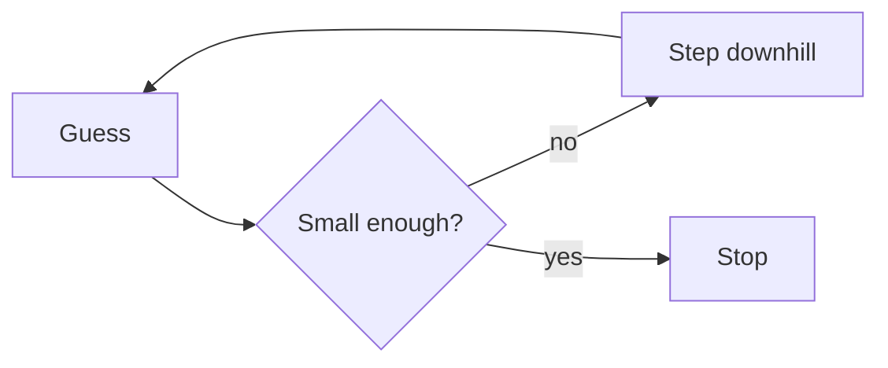

# Diagrams

Obsidian draws a fenced `mermaid` block as a diagram (with Pele, which reads Mermaid 12.1 syntax). Use one when a structure is clearer seen than read: a process or a cycle, causes and effects, a hierarchy, states, events in order, parts of a whole. Not for decoration, and not when three sentences say the same.

## Where

In a reply to a request, in a note you create, or added to a note through propose_edit, as an ordinary fenced block:

## Choose the type

flowchart (a process, causes), sequenceDiagram (who does what, in order), stateDiagram-v2 (states and transitions), classDiagram or erDiagram (structure), mindmap (a topic's parts), timeline (events in order), quadrantChart, pie, xychart (numbers). Every type built into Mermaid 12.1 works; ZenUML and other plugin types do not.

## Pele's rules

- Colours and fonts come from the learner's theme. Do not set themes, %%{init}%% colours, classDef or style.
- Labels are text: a line break is  . No HTML and no $math$ (it shows as TeX source).
- Quote a label that has brackets, colons, quotes or commas: A["Newton's second law: F = ma"].
- To link a node to a note, make its label the note's exact name and give it the class internal-link: B[Momentum], then a line class B internal-link. Only for notes that exist.
- click can only open a URL; JavaScript callbacks are ignored.
- Keep it small, about 15 nodes at most. Split a bigger picture into two diagrams, or make a canvas.
- Labels in the note's language; node ids short and ASCII (A, B, loss).
